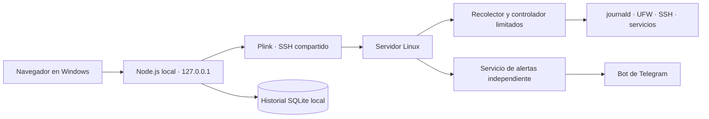

<!--
Server Security Monitor v2.0
Created by FacuSecX
https://github.com/FacuSecX/
-->
# 🛡️ Server Security Monitor v2.0

<p align="center">
  <a href="https://github.com/FacuSecX"></a>
  
  
  
</p>

Supervisá y administrá la seguridad de tu servidor Linux desde un panel web local en Windows. Consultá eventos, gestioná puertos y servicios, investigá direcciones IP y recibí alertas por accesos no autorizados, sin exponer la interfaz web a Internet.

 <br>

<p align="center">
 
</p>

## ✨ Funciones principales

- 📊 **Resumen de seguridad:** eventos registrados, IP únicas, paquetes descartados y nivel de riesgo.
- ⚡ **Actividad en vivo:** filtros por dirección IP, decisión, protocolo, proveedor y puerto.
- 💾 **Historial persistente:** almacenamiento local en SQLite y sincronización incremental de registros del servidor.
- 🌍 **Países y proveedores:** geolocalización, ISP, ASN y estadísticas de tráfico observado.
- 🔐 **SSH:** accesos exitosos, intentos fallidos, métodos de autenticación y usuarios probados.
- 🔎 **Investigación de IP:** historial de una dirección, información de red y evaluación de su ASN.
- 🚫 **Bloqueos:** direcciones IPv4/IPv6, inventario de conjuntos y proveedores, con revisión previa para bloqueos masivos.

## 🚀 Funciones v2.0

- 🔌 **Gestión de puertos:** Consultar reglas y procesos que escuchan, identificar servicios y abrir o cerrar acceso con botones de encendido. Protege los puertos administrativos y distingue IPv4 de IPv6.
- 🔀 **Port Forwarding:** Crear redirecciones de puertos TCP/UDP hacia otra IP o un dominio, consultar las reglas persistentes y eliminarlas desde el panel. Los dominios se resuelven y validan al crear la regla.
- 📈 **Tráfico en puertos:** Analizar los paquetes y direcciones registrados por puerto, separado de su administración.
- 📦 **Instalar servicios:** Instalar FTP seguro y MySQL/MariaDB con los paquetes y comandos correspondientes a la distribución detectada. Son instalaciones opcionales posteriores.
- 📁 **Gestionar FTP:** Crear usuarios, asignarles una raíz aislada y modificar sus permisos. Utiliza FTPS explícito con TLS y usuarios propios, sin conceder una cuenta SSH.
- 🗃️ **Gestionar MySQL:** Crear bases, usuarios y tablas; definir columnas, tipos y permisos por base. Permite acceso externo opcional limitado por IP y con TLS.
- 🗄️ **Bases de datos:** Autenticarse con un usuario de base de datos y explorar tablas en grillas paginadas. Las modificaciones dependen de sus permisos y de las claves disponibles en la tabla. No incluye una consola SQL arbitraria.
- 📄 **Generar reporte SSH:** Generar y descargar los informes del analizador incluido, con sus tablas y formato, desde el submenú SSH.
- 🖥️ **Información del servidor:** Identidad del servidor, CPU, RAM y disco en una barra compacta con actualización cada cinco segundos.
- 🩺 **Sistema:** Consultar servicios y estado del servidor; reiniciarlo con confirmación.
- 🔔 **Notificaciones:** Alertas por accesos exitosos desde IP no autorizadas a SSH, FTP o MySQL; actualización automática, marcado como leído y borrado de leídas.
- ✅ **IP autorizadas:** Añadir o quitar direcciones desde Bloqueos. La lista se guarda en el servidor y se comparte con la detección de alertas.
- 📨 **Alertas de Telegram:** Bot independiente ejecutado en el servidor, configurable desde Sistema → Alertas. Puede continuar enviando con el panel cerrado y permite activar o desactivar el envío desde Telegram.
- 🎨 **Personalizar panel:** Cinco temas, cuatro modos de color, animaciones, sonidos de navegación y tres sonidos de alerta. Conserva las preferencias al volver a abrir.
- 🧹 **Borrado de datos:** Consultar espacio ocupado, limpiar registros y programar limpiezas con estado e historial. Las programaciones se ejecutan en el servidor aunque Windows esté apagado.
- 🛡️ **Protección de comandos:** Una operación administrativa por vez, espera de su respuesta y pausa de cinco segundos entre comandos, también controlada desde el servidor local del panel.
- 🔑 **Conexión SSH:** Autenticación con llave PPK/Pageant o contraseña, elegida en un único archivo de configuración. Reutiliza la conexión SSH.
- ⚙️ **Instalador automático:** Detección de Debian, Ubuntu, CentOS Stream y Arch; instalación de dependencias, progreso, verificaciones y log detallado.

Un evento **Permitido** del firewall indica que el tráfico coincidió con una regla de acceso. **No confirma una autenticación**. Las alertas de acceso se basan en registros o sesiones autenticadas de los servicios; no se disparan por un simple escaneo de puertos. En MySQL, la detección disponible depende del servicio y su registro de conexiones; una comprobación de sesiones puede no observar conexiones muy breves.
 <br>
<p align="center">
 
</p>

## 🏗️ Cómo funciona



La web y el historial local funcionan en Windows. El instalador Linux prepara el recolector y las acciones administrativas; no publica una web en el servidor. Tailscale es opcional: se puede usar una IP o un dominio accesible por SSH.

## 📋 Requisitos

### Windows

- Windows 10/11 con PowerShell.
- **Node.js 24 LTS o posterior compatible con `node:sqlite`**, disponible en [nodejs.org](https://nodejs.org/).
- [PuTTY](https://www.chiark.greenend.org.uk/~sgtatham/putty/latest.html) actualizado, con **Plink**. Para autenticación con llave se utiliza también **Pageant**.
- Acceso SSH al servidor y su huella SHA-256 verificada.
- Opcional: [Tailscale](https://tailscale.com/download) para una conexión privada.

No hace falta `npm install`, compilar la web ni instalar Python en Windows para ejecutar el panel. Los archivos de `dist/` ya están preparados y Node utiliza módulos de su biblioteca estándar.

### Servidor Linux

- **Debian o Ubuntu**, **CentOS Stream 9/10** o **Arch Linux**, con systemd, repositorios activos y paquetes mantenidos.
- Acceso inicial como **root**, o una cuenta con `sudo` para ejecutar el instalador como root.
- Un usuario SSH existente que utilizará el panel.
- Conectividad para instalar paquetes. El instalador exige Python 3.8 o posterior después de instalarlo.

Las versiones antiguas sin repositorios mantenidos o sin los paquetes requeridos pueden no ser compatibles. CentOS Linux 7/8 y Stream 8 se rechazan expresamente. Un contenedor mínimo sin systemd no equivale a un servidor compatible.

## ⚙️ Instalación

### 1. Preparar el servidor

Copiá **`instalar-servidor.sh`** al servidor, por ejemplo mediante SCP o WinSCP. Es un instalador autónomo: contiene el componente Linux necesario.

Desde una sesión SSH, en el directorio donde lo copiaste:

```bash
sudo bash instalar-servidor.sh --usuario usuario_panel
```

Reemplazá `usuario_panel` por tu **usuario SSH existente**. Si ya ingresaste como root, ejecutá `bash instalar-servidor.sh --usuario usuario_panel`.

El instalador detecta la distribución, instala las dependencias faltantes, prepara UFW/iptables/ipset, el recolector, los controladores, permisos limitados de `sudo` y las unidades necesarias. También prepara el componente de Telegram, pero **no lo configura ni lo activa sin un token y un chat**. FTP y MySQL/MariaDB se instalan posteriormente desde el panel.

Muestra progreso en pantalla y guarda la salida detallada y los errores en:

```text
/var/log/server-monitor-installer/instalacion-*.log
```

Opciones disponibles:

| Opción | Uso |
| --- | --- |
| `--usuario NOMBRE` | Usuario SSH que usará el panel. No crea ese usuario. |
| `--ip-admin IP` | Añade una IP administrativa; se puede repetir. |
| `--sin-tailscale` | Omite la preparación de Tailscale si vas a utilizar otro canal SSH. |
| `--iniciar-tailscale` | Muestra el enlace de autorización para conectar el servidor a tu red Tailscale. |
| `--comprobar` | Diagnostica requisitos sin instalar ni cambiar la red; conserva su log. |
| `--migrar-firewall` | Autoriza la migración desde firewalld/nftables a UFW con respaldo. **No traduce reglas ajenas**. |
| `--ayuda` | Muestra la ayuda. |

Por defecto prepara Tailscale si falta. Si no lo vas a usar:

```bash
sudo bash instalar-servidor.sh --usuario usuario_panel --sin-tailscale
```

Detecta la IP de la sesión SSH y la del servidor para la configuración inicial de direcciones autorizadas. Revisá después **Bloqueos → IP autorizadas**. Esta lista evita alertas por accesos conocidos; no concede permisos de autenticación ni sustituye las reglas del firewall.

Si hay otro firewall activo, el instalador se detiene antes de superponer UFW. Revisá sus reglas y conservá acceso por consola de recuperación antes de usar `--migrar-firewall`. No lo uses a ciegas en un servidor que ya presta servicios.

### 2. Obtener la huella del servidor

En el servidor:

```bash
sudo ssh-keygen -lf /etc/ssh/ssh_host_ed25519_key.pub -E sha256
```

Copiá el valor `SHA256:...` y verificalo por un canal confiable. Si tu servidor utiliza otra clave de host, obtené la huella de esa clave. La huella es obligatoria para los dos modos de autenticación.

### 3. Configurar Windows

Descargá o cloná el repositorio. Desde su carpeta, en PowerShell:

```powershell
Copy-Item .\config.example.json .\config.json
notepad .\config.json
```

**El panel lee `config.json`; no utiliza un archivo `.env` para esta configuración.** Sustituí los valores de ejemplo. Nunca publiques tu `config.json`.

| Campo | Descripción |
| --- | --- |
| `listenHost` | Dirección local de la web. Conservá `127.0.0.1`. |
| `listenPort` | Puerto local del panel; por defecto `8766`. |
| `refreshSeconds` | Intervalo del recolector general, en segundos. |
| `initialHistoryHours` | Ventana inicial de registros que se recuperarán. |
| `geoLookup` | Habilita o deshabilita consultas externas de geolocalización. |
| `maxGeoLookupsPerCycle` | Límite de búsquedas geográficas por ciclo. |
| `trustedSshIps` | Lista local inicial. La administración habitual de IP autorizadas se realiza en el panel y se guarda en Linux. |
| `reports.maxDays` | Límite del período de informes, entre 1 y 7 días. |
| `ssh.host` | IP pública, IP de Tailscale o dominio del servidor. |
| `ssh.port` | Puerto de SSH. Por defecto `22`. |
| `ssh.user` | El mismo usuario autorizado durante la instalación Linux. |
| `ssh.hostKeyFingerprint` | Huella real SHA-256 de la clave de host SSH. |
| `ssh.plinkPath` | Ruta de `plink.exe`. |
| `ssh.authMode` | `key` para llave o `password` para contraseña. |
| `ssh.pageantPath` | Ruta de Pageant, utilizada en modo `key`. |
| `ssh.keyPath` | Ruta de tu llave PPK. Puede estar vacía si ya está cargada en Pageant. |
| `ssh.passwordEnv` | Nombre de la variable opcional que contiene la contraseña. No es la contraseña. |
| `nodePath` | Campo opcional en la raíz del JSON para indicar la ruta de Node si no está en PATH. |

#### Con llave PPK

Dentro de `ssh`, configurá:

```json
{
  "host": "servidor.example.com",
  "port": 22,
  "user": "usuario_panel",
  "authMode": "key",
  "plinkPath": "C:\\Program Files\\PuTTY\\plink.exe",
  "pageantPath": "C:\\Program Files\\PuTTY\\pageant.exe",
  "keyPath": "C:\\Claves\\servidor.ppk",
  "hostKeyFingerprint": "SHA256:REEMPLAZAR_POR_LA_HUELLA_REAL",
  "passwordEnv": "SERVER_MONITOR_SSH_PASSWORD"
}
```

Al iniciar, abre Pageant si hace falta y permite cargar o desbloquear la llave. La llave privada permanece en Windows.

#### Con contraseña SSH

Dentro de la misma sección `ssh`, cambiá:

```json
{
  "authMode": "password",
  "keyPath": "",
  "passwordEnv": "SERVER_MONITOR_SSH_PASSWORD"
}
```

Conservá `host`, `user`, `port`, `plinkPath` y `hostKeyFingerprint` con sus valores reales. **No agregues un campo `password` a `config.json`.**

Ejecutá el BAT: solicitará la contraseña de forma oculta y **no abrirá Pageant**. El servidor debe tener habilitado ese método de autenticación; el panel no cambia su política SSH.

Variables de entorno opcionales en Windows:

| Variable | Función |
| --- | --- |
| `SERVER_MONITOR_NODE` | Ruta de `node.exe` si no se encuentra en PATH. |
| `SERVER_MONITOR_SSH_PASSWORD` | Contraseña para una ejecución automatizada. Si no existe, se pide de forma oculta. Podés usar otro nombre mediante `ssh.passwordEnv`. |

Para una sesión de PowerShell, la ruta de Node se puede indicar así:

```powershell
$env:SERVER_MONITOR_NODE = 'C:\Program Files\nodejs\node.exe'
.\iniciar-panel.bat
```

Es preferible ingresar la contraseña en el aviso oculto. No la escribas en un BAT, en el README ni en un comando que quede en el historial. El modo contraseña prepara un archivo temporal privado con permisos restringidos antes de escribir el secreto, y lo elimina al completar la autenticación o ante un error; no lo incluye en los argumentos de Plink.

### 4. Verificar y abrir

Ejecutá en Windows:

```text
verificar-conexion.bat
iniciar-panel.bat
```

La web se abre en **http://127.0.0.1:8766**, salvo que cambies `listenPort`. La primera sincronización puede tardar más que las siguientes. Para detener el panel, cerrá su consola.

`instalar-control-vps.bat` permite instalar o actualizar el componente de administración usando la conexión configurada cuando las dependencias ya están preparadas. Para preparar un servidor desde cero, utilizá primero **`instalar-servidor.sh`**.

## 🔔 Configurar alertas de Telegram

1. Creá un **bot nuevo** con BotFather y obtené su token.
2. Iniciá una conversación con ese bot y obtené el chat ID del destino. El chat ID no lo entrega BotFather.
3. Abrí **Sistema → Alertas** en el panel. Ingresá token, chat ID y, si corresponde, el ID del administrador autorizado para usar sus controles.
4. Activá el envío y guardá. El formulario limpia los datos sensibles después de enviarlos por SSH al servidor.
5. Revisá el estado que devuelve el panel. El servicio empieza a funcionar sin reiniciar el servidor y queda preparado para los siguientes arranques.

El proceso independiente `server-monitor-alerts.service` funciona **en Linux**, por lo que puede seguir enviando alertas aunque cierres la web o apagues Windows. Sus botones de Telegram permiten activar o desactivar el envío y el panel recupera ese estado al conectarse. Pausar el envío desde Telegram mantiene el proceso de control activo para poder reactivarlo.

El mensaje incluye fecha, dirección IP, país, ISP y servicio cuando esos datos están disponibles. Utiliza la lista actual de IP autorizadas del servidor. El componente nuevo no necesita reutilizar el token ni reemplazar un bot externo preexistente.

La configuración con el token se guarda en `/etc/storypulse-security/panel-alerts.json`, protegida para root. No se distribuye con el repositorio. El navegador puede requerir una primera interacción para habilitar sonidos; luego el panel recuerda las alertas ya sonadas en ese navegador, independientemente de si se leyeron.

## 📄 Informes SSH

Desde **SSH → Generar reporte**, elegí el período, generá el informe y descargá sus archivos. El servidor ejecuta únicamente el analizador incluido y verificado, no un comando ni una ruta ingresados desde la web.

- Analizador instalado: `/usr/local/lib/storypulse-security/ssh_security.ssh`.
- Informes del servidor: `/var/lib/storypulse-security/Informes/SSH/archivos/`.
- Descargas locales: `Informes/SSH/archivos/` dentro del proyecto.

## 🗑️ Borrado de datos

La sección muestra el espacio de los registros y del disco. Permite una limpieza manual o programaciones persistentes con estados, cancelación e historial. La ejecución la realiza el servidor con systemd; no depende de que la web esté abierta. Un fallo de ejecución se muestra como error y no se confunde con una limpieza completada.

**La limpieza es destructiva:** alcanza el journal del sistema y los registros incluidos en su alcance, además del historial local del panel al sincronizar. Puede borrar evidencia útil para una investigación y afectar el historial disponible para otros monitores. Revisá el alcance mostrado antes de confirmar. No elimina usuarios, bases de datos de MySQL ni la configuración de servicios.

## 🔒 Seguridad y privacidad

- Interfaz local, validación de origen y host, protección de acciones mediante token y confirmaciones.
- Parámetros con validación específica; no ofrece una terminal ni acepta comandos remotos arbitrarios.
- Controlador y recolector instalados como root en rutas fijas, con permisos `sudo` limitados para el usuario del panel.
- Operaciones administrativas serializadas y espera entre comandos; validaciones también en Linux.
- Configuraciones sensibles, llaves, bases locales, logs e informes excluidos de Git.
- FTP con TLS, raíces aisladas y permisos por usuario. MySQL no necesita abrir el puerto a Internet para usarlo desde el panel; el acceso externo es opcional.
- Los cambios de red pueden afectar servicios existentes. Revisá las confirmaciones y conservá un acceso administrativo de recuperación.

La geolocalización local consulta ip-api.com y la evaluación de ASN utiliza RIPEstat; el componente de alertas utiliza ipwho.is cuando necesita datos geográficos. Estas consultas comunican las IP consultadas a terceros. Podés deshabilitar la geolocalización del panel con `geoLookup: false`; eso no deshabilita por sí solo la búsqueda geográfica del bot independiente.

Un ASN puede incluir redes compartidas o residenciales. Para un bloqueo masivo, revisá su titular y prefijos. Copiá `provider-approvals.example.json` como `provider-approvals.json` y completá el ASN, la huella `prefix_digest`, fecha y justificación de la evaluación. Una aprobación de ejemplo no habilita ningún bloqueo real.

El proyecto sirve para administración defensiva de servidores propios. No reemplaza copias de seguridad, un SIEM ni un IDS/IPS.

## 📂 Archivos y datos generados

| Ruta | Contenido |
| --- | --- |
| `config.example.json` | Plantilla pública; copiar a `config.json`. |
| `provider-approvals.example.json` | Plantilla para decisiones de bloqueo de proveedores. |
| `dist/` | Interfaz lista para ejecutar. |
| `vps/` | Fuentes y unidades del componente Linux. |
| `instalar-servidor.sh` | Instalador autónomo para Linux. |
| `generar-instalador.py` | Regenera el instalador desde sus fuentes; requiere Python sólo para esa tarea de desarrollo. |
| `data/storypulse.db` | Historial local creado durante la ejecución; no se publica. |
| `Informes/SSH/archivos/` | Informes descargados; no se publican. |
| `/etc/storypulse-security/` | Configuración persistente y credenciales del componente Linux. |
| `/var/lib/storypulse-security/` | Estado e informes administrados en el servidor. |

Los nombres internos `storypulse-*` se mantienen por compatibilidad entre los componentes. No es necesario cambiarlos para utilizar el panel.

Si modificás el analizador SSH, sus verificaciones SHA-256 en `vps/storypulse_report.py` y `vps/instalar-control-bloqueos.sh` deben coincidir con el archivo nuevo antes de regenerar el instalador. Para cambios normales del resto de las fuentes Linux, ejecutá `python generar-instalador.py` desde la carpeta del proyecto.

## 🤝 Autor

**Panel creado por [FacuSecX](https://github.com/FacuSecX/) · Versión 2.0**

[Telegram](https://t.me/FacuSecX) · [Apoyar el proyecto en PayPal](https://paypal.me/FacuSecX)
