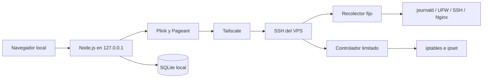

# 🛡️ Server Security Web Panel
<br>

<p align="center">
 
</p>

<p align="center">
<a href="https://github.com/FacuSecX"></a>
<a href=""></a>
</p>

<p align="center">
<a href=""></a>
<a href="https://paypal.me/FacuSecX"></a>
</p>

<p align="center">
<a href="mailto:facusex@gmail.com"></a>
<a href="https://t.me/FacuSecX"></a>


Server Security es un panel web interactivo que sirve para supervisar y administrar en tiempo real todo el tráfico entrante de red que registran el firewall y los servicios de tu servidor, desde un panel local. Se conecta al VPS por SSH mediante PuTTY/Plink y una clave SSH si el servidor lo requiere: la clave privada permanece en Windows y la clave pública autorizada se instala en el servidor.

El panel reúne eventos de `journald`, UFW, iptables/ipset, SSH y Nginx, y los presenta en una interfaz gráfica sin exponer el panel web en Internet.

El proyecto está pensado para análisis defensivo y administración de servidores propios. No reemplaza un SIEM, un IDS/IPS ni una estrategia de copias de seguridad.


## ✨ Funciones principales

* 📊 **Resumen de seguridad:** eventos registrados, IP únicas, paquetes descartados y nivel de riesgo.
* ⚡ **Actividad en tiempo real:** filtros por decisión, protocolo, IP, proveedor y puerto.
* 💾 **Historial persistente:** base de datos SQLite para conservar eventos entre reinicios del panel.
* 🌍 **Geolocalización visual:** países con banderas, proveedores/ISP y anuncios BGP asociados a cada IP.
* 🔐 **Monitoreo SSH:** accesos exitosos, fallos, usuarios probados, país, ISP y ASN.
* 🎯 **Puertos y protocolos:** objetivos observados y detalle de las IP que intentaron acceder a cada uno.
* 🔎 **Investigación de IP:** consulta del historial completo de una dirección concreta.
* 🧱 **Proveedores bloqueados:** inventario de reglas activas y contadores de paquetes `DROP`.
* 🚫 **Bloqueos manuales:** bloqueo y desbloqueo de direcciones IPv4/IPv6 públicas mediante ipset.
* 🛰️ **Evaluación de ASN:** análisis con RIPEstat y aprobación explícita antes de un bloqueo masivo.
* 📄 **Reportes SSH:** generación opcional de informes mediante un componente administrado en el VPS.
* 🩺 **Estado del sistema:** uso de disco, memoria, Tailscale, UFW y servicios systemd.

> ⚠️ **Importante:** un evento “Permitido” significa que una conexión nueva coincidió con una regla `ALLOW` del firewall. No confirma por sí solo una autenticación SSH o una solicitud web exitosa.

<p align="center">
 
</p>

## 🏗️ Arquitectura



El proceso Node mantiene una conexión SSH compartida mientras el panel está abierto. Las actualizaciones reutilizan ese canal y no vuelven a autenticar cada pocos segundos.

## 🔒 Modelo de seguridad

- El servidor web local sólo acepta `127.0.0.1`, `::1` o `localhost`.
- La clave privada nunca se copia al VPS ni se guarda en el repositorio; Pageant la mantiene desbloqueada en Windows.
- La huella del host SSH es obligatoria para impedir conexiones a un servidor suplantado.
- El recolector y el controlador se instalan con propietario `root` en rutas fijas.
- `sudoers` autoriza únicamente el recolector fijo y operaciones concretas del controlador; no autoriza una shell general.
- Las operaciones que modifican el firewall exigen confirmación en la interfaz y un token local efímero.
- Tailscale, las direcciones asignadas al VPS, la conexión administrativa activa y las redes configuradas por el administrador se protegen contra bloqueos accidentales.
- Los archivos `.env`, las aprobaciones, la base SQLite, los registros y los reportes están excluidos de Git.

Revisa también [SECURITY.md](SECURITY.md) antes de habilitar acciones de bloqueo.

## 📋 Requisitos

### 🪟 Windows

- Windows 10 u 11.
- [Node.js 22.13 o posterior](https://nodejs.org/).
- [PuTTY](https://www.chiark.greenend.org.uk/~sgtatham/putty/latest.html), incluyendo Pageant y Plink.
- [Tailscale](https://tailscale.com/download/windows).
- Una clave SSH en formato PPK protegida con frase secreta.
- Opcional: WinSCP y un descargador local para reportes.

No hay dependencias npm externas: el servidor usa módulos incluidos en Node.js, entre ellos `node:sqlite`.

### 🐧 VPS Linux

- Debian o Ubuntu con systemd y `journald`.
- Python 3.10 o posterior.
- OpenSSH Server, UFW, iptables e ipset.
- Tailscale.
- Nginx es opcional; si existe, se analiza `/var/log/nginx/access.log`.
- Opcional: un servicio externo compatible con reglas `UFW-VPS:` y conjuntos `uvp_*` para inventariar listas de proveedores ya existentes.

## ⚙️ Archivos de configuración

La configuración local se lee desde `.env`. Crea ese archivo a partir de `.env.example`; nunca publiques el archivo resultante.

| Variable | Uso |
| --- | --- |
| `SERVER_SECURITY_SSH_HOST` | IP Tailscale o nombre MagicDNS del VPS. |
| `SERVER_SECURITY_SSH_USER` | Usuario administrativo SSH no-root. |
| `SERVER_SECURITY_SSH_HOST_KEY` | Huella SHA-256 verificada de la clave del host. |
| `SERVER_SECURITY_SSH_KEY_PATH` | Ruta local de la clave PPK; puede omitirse si Pageant ya la tiene cargada. |
| `SERVER_SECURITY_PLINK_PATH` | Ruta local de `plink.exe`. |
| `SERVER_SECURITY_PAGEANT_PATH` | Ruta local de `pageant.exe`. |
| `SERVER_SECURITY_TRUSTED_SSH_IPS` | IP administrativas que no deben generar alertas, separadas por coma. |
| `SERVER_SECURITY_REFRESH_SECONDS` | Intervalo de actualización; mínimo 10 segundos. |
| `SERVER_SECURITY_GEO_LOOKUP` | Activa o desactiva la geolocalización externa. |
| `SERVER_SECURITY_REPORT_*` | Rutas y límite del módulo opcional de reportes. |

El controlador del VPS usa `/etc/server-security/settings.json`. Su plantilla está en `vps/server-security-settings.example.json`.

## 🌐 Geolocalización y fuentes externas

Cuando la geolocalización está activa, el equipo local envía direcciones IP observadas a la API por lotes de ip-api.com. La evaluación de proveedores consulta RIPEstat para obtener el ASN y sus prefijos anunciados. Desactiva `SERVER_SECURITY_GEO_LOOKUP` si tu política no permite esas consultas.

Un anuncio BGP no demuestra que todo un ASN sea exclusivamente de hosting. Antes de bloquearlo, comprueba su titular, posibles clientes residenciales, redes compartidas y fuentes oficiales. El panel exige que el ASN y la huella SHA-256 exacta de sus prefijos estén en `provider-approvals.json`.

Flujo recomendado:

1. Evalúa una IP o ASN desde **Bloqueos**.
2. Revisa el titular, todos los prefijos y las fuentes enlazadas.
3. Copia `provider-approvals.example.json` como `provider-approvals.json`.
4. Registra el ASN, el `prefix_digest` mostrado, la fecha y la justificación.
5. Reinicia el panel, repite la evaluación y confirma el bloqueo desde la interfaz.

Si los prefijos cambian, la aprobación deja de coincidir y el botón vuelve a deshabilitarse.

## 🗄️ Datos y privacidad

- `data/server-security.db` contiene el historial recopilado y se crea al iniciar.
- `/etc/server-security/*.json` contiene las reglas persistentes del VPS.
- `/var/log/server-security-blocks.jsonl` registra las acciones administrativas.
- `provider-approvals.json` contiene decisiones locales de revisión.

No publiques esos archivos. La distribución no incluye bases de datos, IP reales, usuarios, rutas personales, claves, contraseñas ni huellas SSH.

## 📑 Reportes SSH opcionales

El controlador sólo ejecuta el archivo definido como `report_script` en `/etc/server-security/settings.json`. Debe aceptar:

```text
--since "N minutes ago" --all --output-dir RUTA
```

El generador debe crear archivos `.txt` o `.csv` cuyos nombres comiencen con `ssh_reporte_` o `ssh_eventos_`. Configura en `.env` el directorio remoto, el directorio local y, si corresponde, un archivo BAT descargador que acepte el argumento `--panel`.

## 🧪 Desarrollo y comprobaciones

```powershell
npm run check
npm test
```

Las pruebas no contienen datos de ningún servidor y no necesitan un VPS real.

## 🚀 Manual de instalación

### 1. 🔗 Preparar Tailscale

Instala Tailscale en Windows desde su [descarga oficial](https://tailscale.com/download/windows) e inicia sesión. En el VPS, usa el instalador oficial:

```bash
curl -fsSL https://tailscale.com/install.sh | sh
sudo systemctl enable --now tailscaled
sudo tailscale up
tailscale ip -4
```

Conecta Windows a la misma tailnet y comprueba que el VPS aparezca en `tailscale status`. La documentación oficial también explica la [instalación en Linux](https://tailscale.com/docs/install/linux) y el [uso de la CLI](https://tailscale.com/kb/1080/cli).

### 2. 🧱 Preparar SSH y el firewall

Prueba primero el acceso por la IP de Tailscale con tu clave. Mantén abierta una segunda consola o el acceso de recuperación del proveedor antes de cambiar UFW, para evitar quedar fuera. Consulta también la [guía oficial de UFW de Ubuntu](https://ubuntu.com/server/docs/how-to/security/firewalls/).

En una instalación donde SSH deba aceptar conexiones sólo por Tailscale:

```bash
sudo apt update
sudo apt install -y python3 openssh-server ufw iptables ipset
sudo ufw default deny incoming
sudo ufw default allow outgoing
sudo ufw allow in on tailscale0 to any port 22 proto tcp comment 'SSH via Tailscale'
sudo ufw logging low
sudo ufw enable
sudo ufw status verbose
```

Si el VPS sirve una web mediante Cloudflare, agrega antes reglas `ALLOW` para los rangos actuales publicados por Cloudflare y coloca después los bloqueos generales de 80/443. Conserva esos rangos actualizados desde la [fuente oficial de Cloudflare](https://www.cloudflare.com/ips/) y añádelos también a `protected_networks` en `/etc/server-security/settings.json`. El panel observa las reglas existentes; no configura automáticamente la exposición web.

Obtén la huella del host directamente en el VPS y compárala por un canal confiable:

```bash
sudo ssh-keygen -lf /etc/ssh/ssh_host_ed25519_key.pub -E sha256
```

Desactiva la autenticación por contraseña sólo después de confirmar que el acceso por clave funciona.

### 3. 🖥️ Configurar Windows

Clona o extrae el proyecto y, desde su directorio:

```bat
copy .env.example .env
```

Edita `.env` y completa como mínimo:

- `SERVER_SECURITY_SSH_HOST`
- `SERVER_SECURITY_SSH_USER`
- `SERVER_SECURITY_SSH_HOST_KEY`
- `SERVER_SECURITY_SSH_KEY_PATH`

No subas `.env` a GitHub.

### 4. 🛠️ Instalar el componente del VPS

Ejecuta `instalar-control-vps.bat`. El instalador copia el recolector y el controlador, crea los conjuntos persistentes y añade permisos `sudo` limitados. En muchos VPS el usuario administrativo ya dispone de `sudo` sin contraseña; si no es así, realiza esta primera instalación desde una sesión SSH interactiva con privilegios y ejecuta:

```bash
sudo sh vps/instalar-control-bloqueos.sh \
  vps/server-securityctl.py \
  vps/server-security-settings.example.json \
  collector.py
```

Después verifica en el VPS:

```bash
sudo /usr/local/sbin/server-securityctl status
sudo systemctl status server-security-manual-blocks.service --no-pager
```

### 5. ✅ Verificar y ejecutar

En Windows, carga la clave en Pageant y ejecuta:

```text
verificar-conexion.bat
iniciar-panel.bat
```

El navegador abrirá `http://127.0.0.1:8765`. La primera sincronización puede tardar unos segundos; después el panel se actualiza automáticamente por la conexión SSH persistente.

Para detenerlo, cierra la ventana de Server Security. Los registros ya existentes permanecen en la base SQLite local y los eventos nuevos del VPS se recuperarán mientras sigan disponibles en `journald`.
